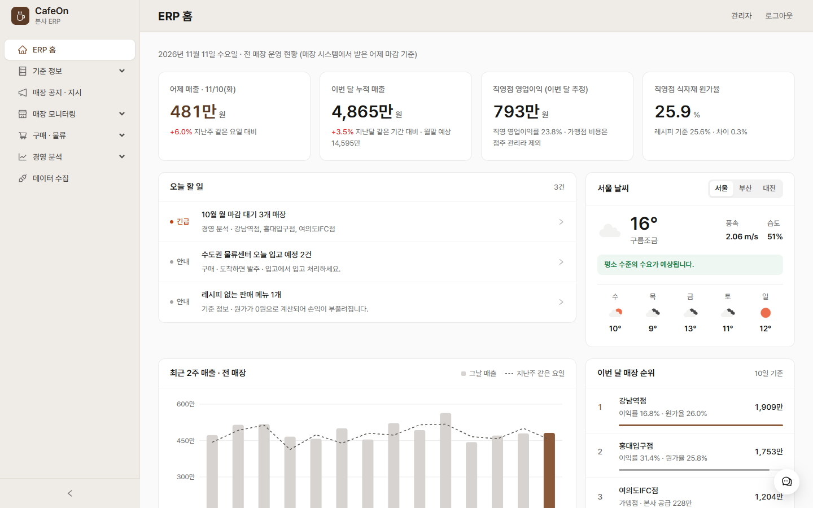
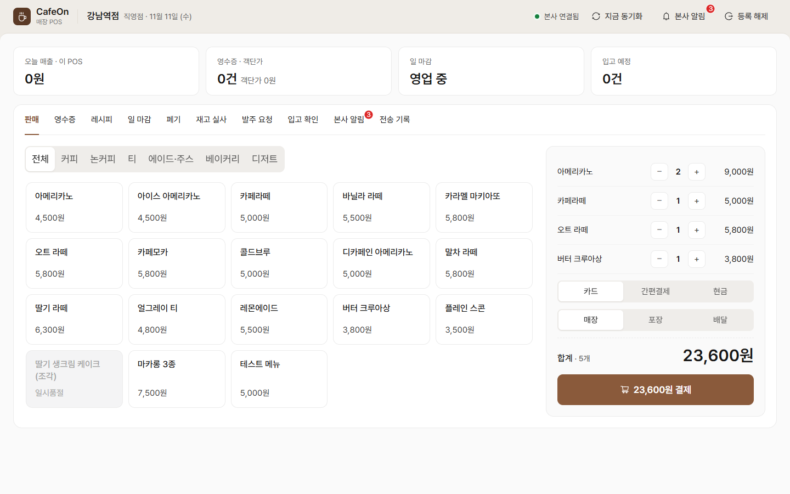
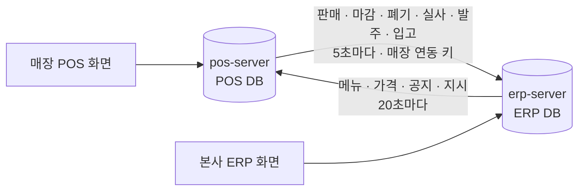
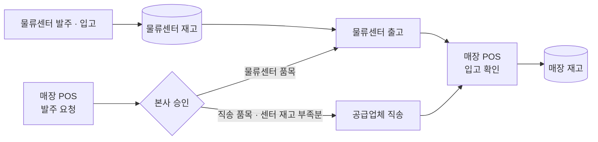
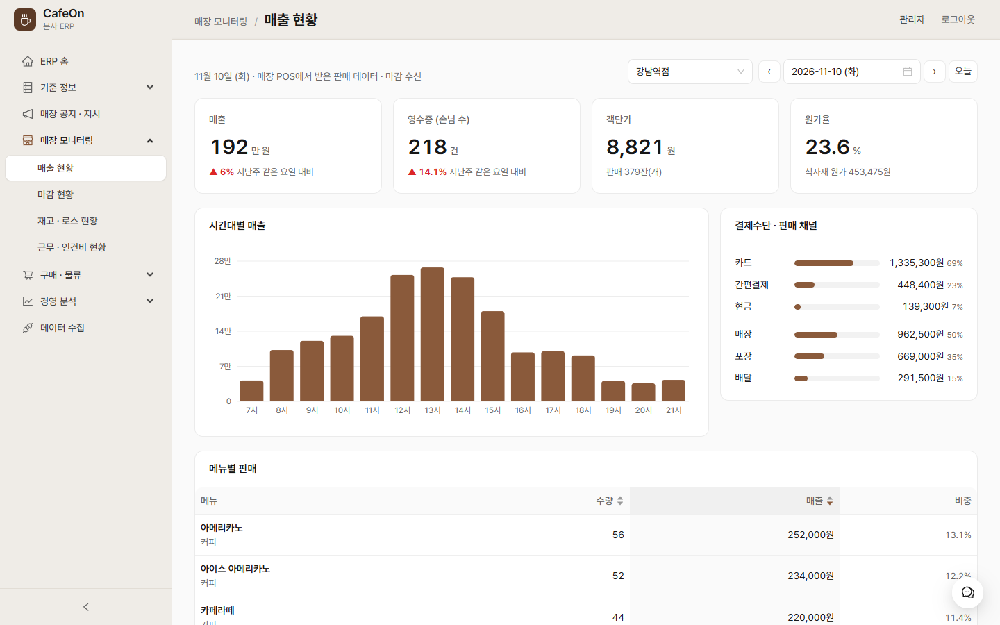
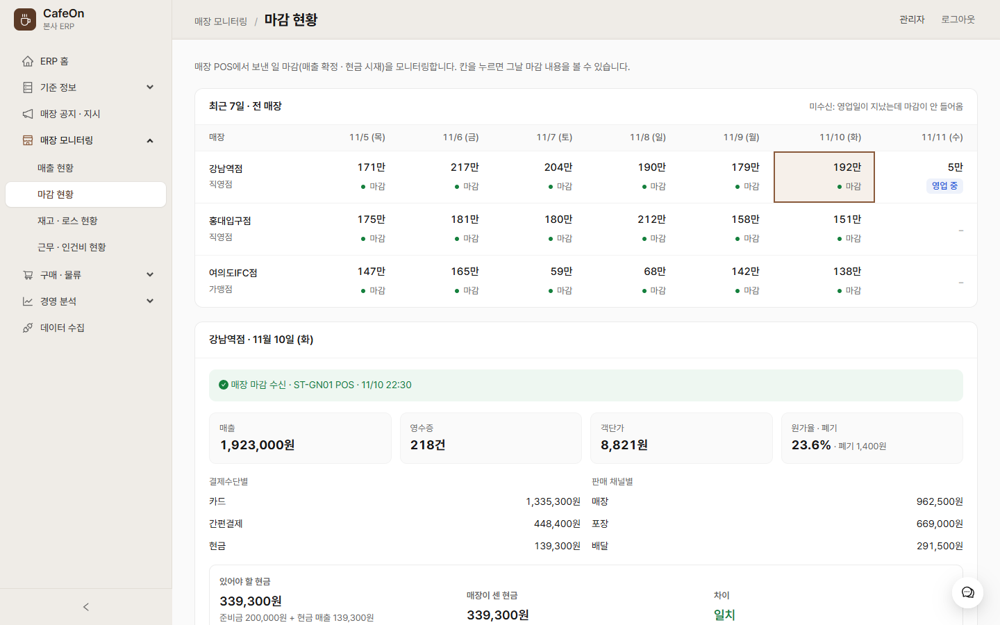
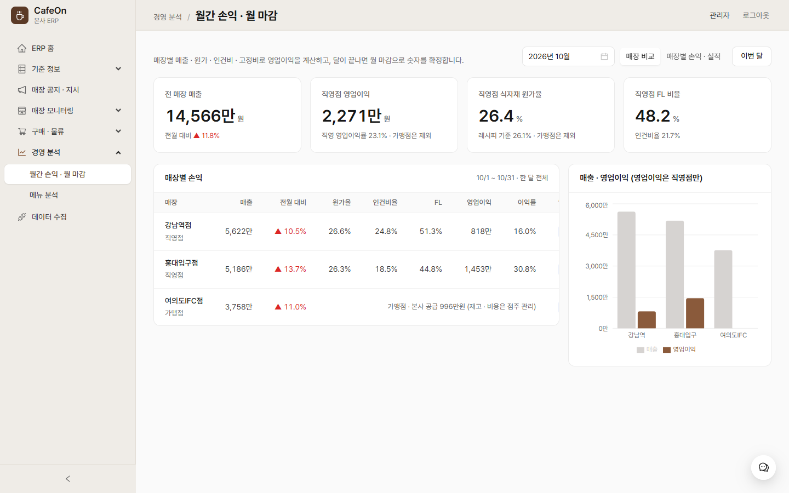
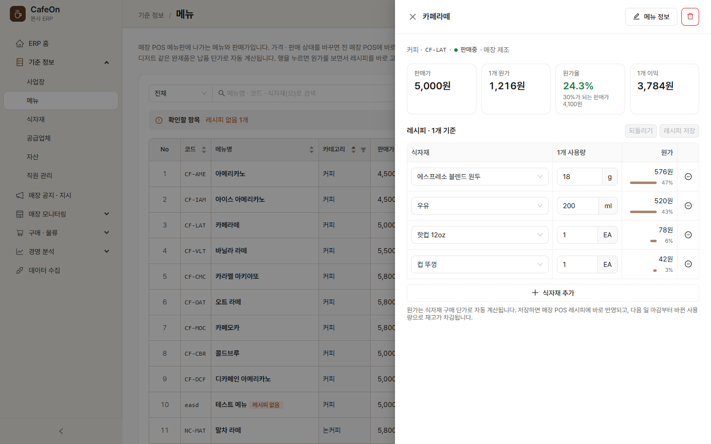
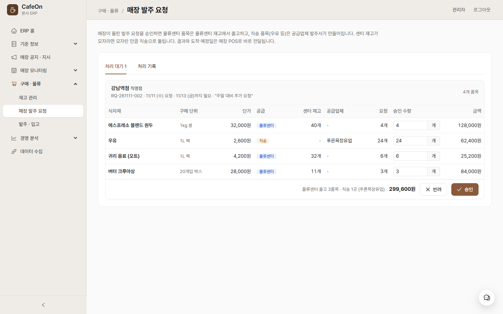
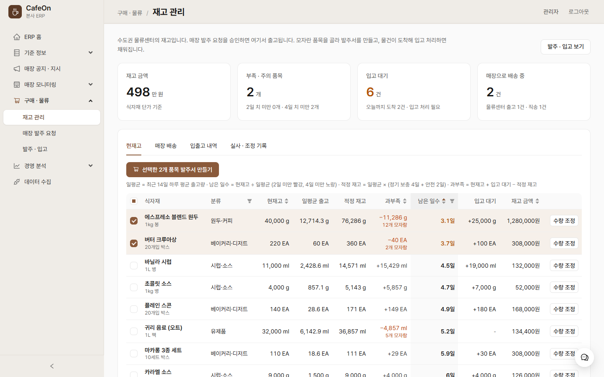

<h1>CafeOn</h1>

카페 프랜차이즈 본사 ERP · 매장 POS 운영 시스템

  
  
  
  
  

<table>
  <tr>
    <td width="50%"></td>
    <td width="50%"></td>
  </tr>
  <tr>
    <td align="center">본사 ERP 홈</td>
    <td align="center">매장 POS 판매</td>
  </tr>
</table>

몇 년 전 팀 프로젝트로 만든 카페 ERP **CafeOn**을 다시 개선.

- **처음 버전 (팀 프로젝트):** 본사 ERP + 공장(센트럴키친) MES + 인증 서버. 기준 정보 등록 · 조회와 공장 생산 관리 중심
- **지금 버전 (개인 개선):** 본사 ERP + 매장 POS. 프랜차이즈 운영의 중심인 매장을 시스템에 연결해, 본사와 매장이 매일 · 매주 · 매달 하는 일이 실제로 돌아가도록 개편

## 주요 구현

- 매장 POS → 본사 ERP 데이터 연동 (전송 대기열, 본사 서버 중단 시 보관 후 재전송, 매장별 연동 키)
- 일 마감, 주간 발주, 월간 손익 · 월 마감까지 이어지는 운영 업무
- 매장 발주 요청 승인 시 물류센터 출고 / 공급업체 직송 자동 분기, 물류센터 재고 부족분은 직송으로 전환
- 재고는 기록으로만 변동. 마감 전 판매가 레시피대로 쓴 양까지 반영해 영업 중에도 실사 가능
- 직영점과 가맹점 구분 관리. 직영점은 재고 · 원가 · 인건비까지 손익을 보고, 가맹점은 매출과 본사 공급액만 관리
- 메뉴 원가 · 적정 재고 · 자산 감가상각 같은 계산 값은 입력 대신 자동 계산
- 매장 영업 시뮬레이터: 매장 직원처럼 POS API로 하루 영업을 돌려 실제 연동 경로로 데이터를 쌓음 (빠른 재생 · 실시간)

## 개선한 점

| 항목 | 처음 버전 | 지금 버전 |
|---|---|---|
| **시스템 구성** | 본사 ERP · 공장 MES · 인증 서버 3개 | 본사 ERP · 매장 POS 2개. 서버와 DB를 분리하고 매장 연동 키로 통신 |
| **MES → POS** | 센트럴키친 생산 계획 · 작업 지시를 다루는 공장 MES | 매장 POS로 전환. 매일 데이터가 쌓이는 매장 판매로 바꿔 시스템 간 연동을 구현하고, 요일 · 시간대 패턴이 있는 테스트 데이터로 결과를 검증하기 쉽게 함 |
| **인증** | 별도 인증 서버가 로그인과 서버 간 인증 담당 | 인증 서버를 없애고 ERP 자체 로그인(JWT)으로 통합. 인증 서버 하나가 멈추면 전체가 멈추던 구조를 없애고, 매장 POS는 연동 키와 자체 토큰으로 본사와 끊겨도 동작하도록 설정 |
| **매장 데이터** | 매장에서 올라오는 데이터 없음 | 매장 POS의 판매 · 일 마감 · 폐기 · 재고 실사 · 발주 요청 · 입고 확인을 본사로 자동 전송 |
| **운영 업무** | 등록 · 조회 | 매일 판매와 일 마감, 매주 발주와 근무표, 매달 매장별 손익과 월 마감까지 처리 |
| **구매 · 물류** | 공급업체 발주서 등록 · 조회 | 매장 발주 요청을 본사가 승인하면 물류센터 출고와 공급업체 직송으로 자동 분기. 본사 물류센터 재고에서 모자란 품목을 골라 바로 발주 |
| **자동 계산** | 원가 · 감가상각을 직접 입력 | 식자재 단가로 메뉴 원가와 원가율을, 출고량으로 물류센터 적정 재고와 과부족을, 취득가와 내용연수로 자산 장부가를 자동 계산 |
| **화면** | 모든 메뉴가 같은 모양의 등록 표 | 업무별로 재설계. 열 제목 필터 · 정렬 표, 행 클릭 시 상세 창, 확인할 일을 먼저 보여 주는 홈 |
| **보안 · 정리** | API 키가 소스에 포함 | 비밀값을 저장소 밖으로 분리, 로그인 만료 처리 수정, 안 쓰는 코드 · 패키지 정리 |

## 시스템 구성

| 폴더 | 역할 | 기술 |
|---|---|---|
| `erp-server` | 본사 ERP 서버 | Spring Boot 3.5, Java 17, JPA, MySQL, JWT |
| `pos-server` | 매장 POS 서버 | Spring Boot 3.5, Java 17, JPA, MySQL |
| `web` | ERP · POS 화면 | React 19, Ant Design 5, Recharts |

**테스트 사업장:** 직영점 2곳(강남역 · 홍대입구), 가맹점 1곳(여의도IFC), 수도권 물류센터 1곳

**데이터 흐름**
- 매장 POS는 판매 · 마감을 자기 DB에 먼저 저장하고, 본사로 보낼 내용은 전송 대기열에 적재
- 5초마다 대기열을 본사로 전송하고, 20초마다 본사의 메뉴 · 가격 · 공지를 수신
- 본사 서버가 멈춰도 매장은 판매를 계속하고, 재연결되면 밀린 데이터를 순서대로 전송
- 재고 = 입출고 기록 합계 − 아직 마감 안 한 판매의 레시피 사용량. 마감 때 판매소진으로 확정
- 일 마감 후에는 POS와 본사 모두 그날 판매 · 폐기 입력을 잠금. 매장이 사유를 남기고 마감을 취소하면 다시 열리고, 본사에는 재마감 이력이 남음
- 문서 번호는 `종류-날짜-순번` (예: `RQ-261111-003` 발주 요청, `SO-` 물류센터 출고, `PO-` 공급업체 발주). POS 영수증은 `주문 12번`처럼 그날 순번으로 표시

**매장 영업 시뮬레이터** (데이터 수집 > 매장 영업 시뮬레이터)
- 달력에서 날짜(또는 기간)와 매장을 고르면, 매장 직원처럼 POS API로 그 날 영업을 돌림: 시간대별 판매, 8시 입고 확인, 21시 30분 폐기 · 발주 요청, 22시 일 마감
- 시나리오: 날씨 · 상황(비 · 폭염 · 한파 · 행사 · 공휴일), 손님 수 배율, 배달 비중, 프로모션 메뉴. 매장 성격(번화가 · 저녁 상권 · 오피스) · 요일 · 계절도 반영
- 이상 상황 주입: 본사 연결 끊김 시간대(전송이 쌓였다가 한꺼번에), 특정 식자재 재고 낮게 시작(긴급 발주 확인)
- 본사 업무(요청 승인 · 보충 발주 · 입고)는 기본으로 하지 않아 본사 처리 대기로 쌓임. 고르면 대신 처리
- 속도: 즉시 · 60배속(1시간 = 1분) · 실시간(오늘). 실행 전 예상 손님 · 매출 · 시간대별 손님을 보여 주고, 실행 중엔 결제된 만큼 채움
- 이미 마감한 날을 고르면 그 날부터 이후 기록을 지우고 다시 쌓음 (두 서버의 업무 시계를 그 날로 옮겨 날짜가 맞게 기록)
- 처음 이력은 빠른 재생으로 N일 치를 한 번에 (70일 약 15분)

**발주 · 물류 흐름**

- 식자재마다 공급 방식(물류센터 / 직송)을 지정. 우유 · 얼음처럼 신선도가 중요한 품목은 직송
- 물류센터 출고는 승인 즉시 센터 재고에서 차감하고, 출고를 취소하면 되돌림
- 매장 입고 확인이 본사에 도착하면 발주서는 입고완료, 매장 재고는 받은 수량만큼 증가

## 본사 ERP

| 메뉴 | 기능 |
|---|---|
| **ERP 홈** | 어제 매출과 이번 달 누적(전 매장), 직영점 영업이익과 식자재 원가율, 매장별 순위 표시. 마감 미수신 · 입고 지연 · 발주 요청 대기 · 월 마감 대기처럼 확인할 일을 알림 |
| **기준 정보** | 사업장(매장 · 물류센터), 메뉴 · 레시피, 식자재(공급 방식 포함), 공급업체, 자산, 직원(부서 · 직급 포함) 관리. 메뉴를 누르면 원가 · 원가율 · 이익을 보면서 레시피를 바로 편집하고 원가율 30% 기준 판매가를 확인. 베이커리 · 디저트는 완제품으로 납품 품목 1개를 연결해 원가 · 재고 계산. 자산 장부가는 자동 계산 |
| **매장 공지 · 지시** | 매장 POS로 공지와 지시(회신 필요)를 보내고 확인 · 회신 여부 확인. 발주 결과와 메뉴 · 가격 변경은 자동 알림 |
| **매장 모니터링** | 매장별 매출과 일 마감(현금 시재 포함), 직영점 재고 · 로스와 근무시간 · 인건비(주 52시간, 주휴수당) 확인. 매장 재고는 POS 기록 기준이라 본사에서 직접 수정하지 않고, 가맹점 재고는 점주 관리라 보지 않음 |
| **구매 · 물류** | **재고 관리:** 본사(물류센터) 재고의 현재고 · 일평균 출고 · 적정 재고 · 과부족 · 남은 일수, 모자란 품목을 골라 공급업체별 발주서 만들기(추천 수량), 매장 배송 추적, 입출고 내역, 실사 차이 · 파손 같은 수량 조정 **매장 발주 요청:** 승인 수량 조정, 물류센터 재고와 비교해 출고 · 직송 분할 미리보기 **발주 · 입고:** 물류센터로 들어올 발주서의 입고 처리 · 취소, 발주 기록 |
| **경영 분석** | 직영점은 매출 · 식자재 원가 · 인건비 · 임차료 · 고정비로 월간 손익을, 가맹점은 매출과 본사 공급액을 계산하고 월 마감으로 확정. 메뉴는 판매량과 1개당 이익으로 4가지로 분류 |
| **데이터 수집** | **수신 현황:** 매장별 연동 키 발급, 매장에서 받은 데이터 확인, 고른 매장의 POS 바로 열기(브라우저 탭마다 다른 매장) **매장 영업 시뮬레이터:** 날짜 · 매장 · 시나리오를 정해 POS로 영업을 돌려 데이터 쌓기 |

<table>
  <tr>
    <td width="50%"></td>
    <td width="50%"></td>
  </tr>
  <tr>
    <td align="center">매출 현황 · 시간대별 매출과 결제수단</td>
    <td align="center">마감 현황 · 매장별 일 마감과 현금 시재</td>
  </tr>
  <tr>
    <td width="50%"></td>
    <td width="50%"></td>
  </tr>
  <tr>
    <td align="center">월간 손익 · 매장별 영업이익</td>
    <td align="center">메뉴 · 원가를 보면서 레시피 편집</td>
  </tr>
  <tr>
    <td width="50%"></td>
    <td width="50%"></td>
  </tr>
  <tr>
    <td align="center">매장 발주 요청 · 물류센터 출고와 직송 분할</td>
    <td align="center">재고 관리 · 적정 재고와 과부족, 바로 발주</td>
  </tr>
</table>

## 매장 POS

| 탭 | 기능 |
|---|---|
| **판매 · 영수증** | 메뉴판에서 주문을 담아 결제하고 오늘 판매 내역(주문 번호) 확인. 메뉴와 가격은 본사에서 수신 |
| **레시피** | 본사가 정한 메뉴별 재료와 1잔 사용량 확인. 베이커리 · 디저트는 완제품으로 표시 |
| **일 마감** | 하루 매출을 확정하고 현금 시재 정산. 마감 후에는 그날 판매 · 폐기 잠금, 사유를 남기고 마감 취소 가능 |
| **폐기 · 재고 실사** | 폐기한 식자재와 실제 재고 수량 기록. 실사 기준은 오늘 판매 사용량을 미리 뺀 값이라 영업 중에도 실사 가능 |
| **발주 요청 · 입고 확인** | 식자재 발주를 요청하고, 입고 예정을 물류센터 출고 · 직송으로 구분해 표시. 도착하면 받은 수량으로 입고 확인 |
| **본사 알림** | 본사 공지 · 지시 확인 및 회신 |
| **전송 기록** | 본사로 보낸 데이터 확인. 실패한 건은 재전송하거나 제외 |
